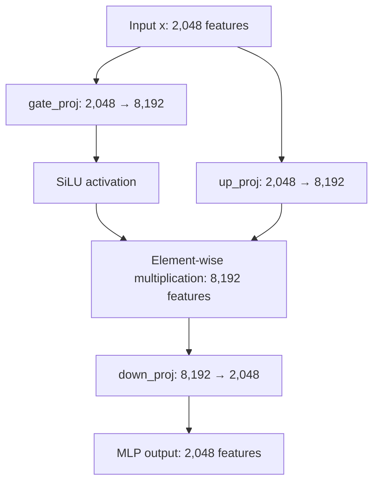

## Basic LLM Finetuning

## Steps

1. Setup
    - `cd` to `llm_fine_tuning_basic`
    - Initialize env using `uv sync`
    - Activate env using `source .venv/bin/activate`
    - Set Python Path using `export PYTHONPATH=$(pwd)`
2. Download and run an MLX model
    - We will run the model `mlx-community/Llama-3.2-1B-Instruct-bf16` in this example
    - `python helpers/run_model.py`
    - First time download can take a while, the size is around `2.48GB`
3. Inspect model layers and parameter counts
    - Same model, `python helpers/inspect_model_layers.py`
4. Download data
    - `python helpers/prepare_data.py --step download`
5. Get Dataset Stats
    - `python helpers/prepare_data.py --step get_dataset_stats`
6. Prepare and check one JSON that will feed into the LLM
    - `python helpers/prepare_data.py --step prepare_json`
7. Save Labels for reference and reuse across other scripts
    - `python helpers/prepare_data.py --step save_labels`
    - There are `77` labels in total, saved as a list by the above step
8. Run Evaluations with the base model
    - `python helpers/run_evaluations.py`
    - Should prepare a runs folder, and a timestep inside that identifying a unique run
    - To just run evaluations, assuming model outputs are already available, run `python helpers/run_evaluations.py --run_id=<RUN_ID>`
    - Key results of the run with the base model are noted below

## Inspect Model Layers (``)
### Model: `mlx-community/Llama-3.2-1B-Instruct-bf16`

#### Parameter Counts

| Component | Parameters |
| --- | ---: |
| Embedding Layer | 262,668,288 |
| Transformer Blocks | 973,144,064 |
| Final Norm Layer | 2,048 |
| LM Head (Tied) | 0 additional |
| Total Model | 1,235,814,400 |

The LM head converts each token’s final hidden representation into scores (logits) for every possible next token; in this model, it shares the embedding weights, so they are counted once.

#### Basic Model Structure

```text
Token IDs
  -> Token embedding (128,256 tokens -> 2,048 features)
  -> Transformer block x 16
       1. RMSNorm -> Self-attention -> Add residual
       2. RMSNorm -> Feed-forward MLP (SwiGLU) -> Add residual
  -> Final RMSNorm
  -> Output projection (shared embedding weights)
  -> 128,256 vocabulary logits per token

Self-attention: q_proj, k_proj, v_proj -> RoPE on Q/K -> causal attention -> o_proj
MLP: down_proj(SiLU(gate_proj(x)) * up_proj(x))
Attention heads: 32 query, 8 key/value
MLP intermediate size: 8,192
```

#### Feed-Forward MLP (SwiGLU)

The MLP expands each token’s 2,048 features to 8,192, applies nonlinear gating to learn richer feature interactions, then projects back to 2,048 features.



The gate and up projections are independent branches that receive the same input. They can be computed in parallel, though actual execution depends on the implementation. SiLU transforms the gate values before they multiply the up-projection values element-wise; the down projection then mixes the result back into 2,048 features.

```python
output = down_proj(silu(gate_proj(x)) * up_proj(x))
```

SiLU is defined as `silu(z) = z * sigmoid(z)`. The gate values are continuous, so they can suppress, amplify, or change the sign of features. The surrounding transformer block adds the MLP output to its residual stream.

#### Transformer Block 0

| Component | Parameters |
| --- | ---: |
| Block 0 Total | 60,821,504 |
| Input RMSNorm | 2,048 |
| Post-Attn RMSNorm | 2,048 |

Matrix shapes are `(output features, input features)`.

##### Self-Attention Matrices

| Matrix | Parameters | Shape | Dtype |
| --- | ---: | --- | --- |
| Query (q_proj) | 4,194,304 | `(2048, 2048)` | `mlx.core.bfloat16` |
| Key (k_proj) | 1,048,576 | `(512, 2048)` | `mlx.core.bfloat16` |
| Value (v_proj) | 1,048,576 | `(512, 2048)` | `mlx.core.bfloat16` |
| Output (o_proj) | 4,194,304 | `(2048, 2048)` | `mlx.core.bfloat16` |

##### Feed-Forward (MLP) Matrices

| Matrix | Parameters | Shape | Dtype |
| --- | ---: | --- | --- |
| Gate (gate_proj) | 16,777,216 | `(8192, 2048)` | `mlx.core.bfloat16` |
| Up (up_proj) | 16,777,216 | `(8192, 2048)` | `mlx.core.bfloat16` |
| Down (down_proj) | 16,777,216 | `(2048, 8192)` | `mlx.core.bfloat16` |

## Inspect Data

```python
DatasetDict({
    train: Dataset({
        features: ['text', 'label'],
        num_rows: 10003
    })
    test: Dataset({
        features: ['text', 'label'],
        num_rows: 3080
    })
})
```

Total training data rows:  10003

```python
['text', 'label']
{'text': 'I am still waiting on my card?', 'label': 11}
{'text': ['I am still waiting on my card?', "What can I do if my card still hasn't arrived after 2 weeks?", 'I have been waiting over a week. Is the card still coming?'], 'label': [11, 11, 11]}
```

Total test data rows:  3080

Sample Labels

```python
['activate_my_card', 'age_limit', 'apple_pay_or_google_pay', 'atm_support', 'automatic_top_up', 'balance_not_updated_after_bank_transfer', 'balance_not_updated_after_cheque_or_cash_deposit', 'beneficiary_not_allowed', 'cancel_transfer', 'card_about_to_expire']
```

## Evaluations

### Base Model Statistics (mlx-community/Llama-3.2-1B-Instruct-bf16)

Run is stored in `runs/2026-11-03T104734Z`. It took around 45 minutes to run.

```json
{
  "micro avg": {
    "precision": 0.3479064039408867,
    "recall": 0.18344155844155843,
    "f1-score": 0.24022108843537415,
    "support": 3080.0
  },
  "macro avg": {
    "precision": 0.41010616803226807,
    "recall": 0.1834415584415585,
    "f1-score": 0.20581545546334365,
    "support": 3080.0
  },
  "weighted avg": {
    "precision": 0.41010616803226807,
    "recall": 0.18344155844155843,
    "f1-score": 0.20581545546334365,
    "support": 3080.0
  },
  "invalid_label_rate": 0.4727272727272727
}
```

Invalid label rate itself is quite high.. which means other statistics are going to automatically worsen.
